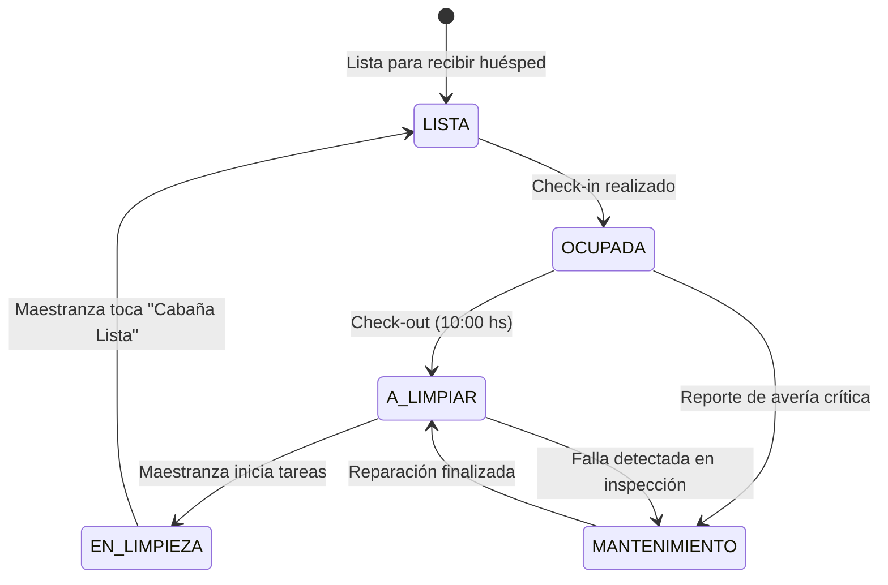

# ⚠️ DOCUMENTO SUPERADO — ARCHIVO HISTÓRICO

> **Este documento NO es la especificación vigente del sistema.**
>
> **Estado:** Superado el 2026-09-28.
> **Reemplazado por:**
> - [`docs/domain/ESPECIFICACION_DOMINIO_V1.md`](../domain/ESPECIFICACION_DOMINIO_V1.md) — reglas de negocio canónicas
> - [`docs/adr/003-fuente-maestra-y-control-de-sobreventa.md`](../adr/003-fuente-maestra-y-control-de-sobreventa.md) — decisión de arquitectura
> - [`docs/GAPS_IMPLEMENTACION.md`](../GAPS_IMPLEMENTACION.md) — distancia entre la norma y el código
> - [`docs/ops/COSTO_Y_MIGRACION_POSTGRES.md`](../ops/COSTO_Y_MIGRACION_POSTGRES.md) — costo real y plan de migración
>
> Si algo aquí contradice esos documentos, **ellos tienen razón**. Este archivo se conserva
> únicamente como registro de qué se propuso, qué se adoptó y qué se descartó.
>
> **Motivo de la copia al repositorio:** es el único de los tres documentos entrantes que se
> adopta parcialmente. Los otros dos —
> `PMS_CABANAS_NECOCHEA_ESPECIFICACION_DEFINITIVA.md` (rechazado: contradice `ADR-001` al proponer
> Beds24 como fuente maestra) y `PMS_Criterios_Produccion.md` (no es una decisión arquitectónica,
> es una rúbrica de evaluación de 17 dominios) — no se copian. Ambos quedan citados por título y
> fecha en la sección de trazabilidad de `ADR-003`.

---

## Qué se adoptó de este documento

| Sección del original | Destino | Nota |
|---|---|---|
| §1.1 Contexto operativo y escala | **Adoptado** | Estacionalidad 75-90 días en dic-feb, 80-90% de conversiones por WhatsApp directo, 3-4 cabañas. Describe el negocio con precisión. |
| §1.2 Principio rector | **Adoptado** | "Automatizar únicamente cuando genere una reducción comprobable del esfuerzo humano". |
| §2.2 Matriz de clasificación de integración | **Adoptado** | La lógica de decidir qué se integra y con qué intensidad. |
| §5.1 Constantes comerciales | **Adoptado y corregido** | Sena: el original dice 30-50%; la norma canónica fija **50%** (ver `ESPECIFICACION_DOMINIO_V1` §1). Bloqueo: el original dice 2 h plano; la norma fija **2 h en `alta` y 4 h en el resto**. |
| Cadenas de integración (WhatsApp, Mercado Pago, iCal, maestranza) | **Adoptado como referencia** | La prioridad de las automatizaciones es correcta y sigue siendo válida. |
| Criterios de producción (§7 en adelante) | **Adoptado como referencia** | Complementa `PMS_Criterios_Produccion.md`. |

## Qué se descartó, y por qué

| Afirmación del original | Problema | Sustituto |
|---|---|---|
| **§1.3 — "Tasa de overbooking: 0%, garantizado"** | **Falsa.** Con sincronización iCal no es alcanzable. Airbnb documenta que su calendario importado se actualiza **cada 3 horas** ([Airbnb Help, art. 99](https://www.airbnb.com/help/article/99)); Booking.com va 2-6 h. iCal es *pull*: la OTA no recibe un push al confirmar una reserva directa. | `ADR-003` §"Cadena de control" y §"Riesgo residual", que enuncia la ventana de 3-6 h y las mitigaciones M1/M2/M3. |
| **§4.1 — "La sincronización con OTAs vía iCal tiene una latencia de 15 a 45 minutos"** | **Incorrecta.** La cifra real es 3 h en Airbnb. | `ESPECIFICACION_DOMINIO_V1` §6, con fuente. |
| **§11 — WhatsApp: "primeras 1.000 conversaciones de servicio/mes gratis" y costo "$0.00"** | **Incorrecta.** Meta cobra por mensaje entregado desde el 1-jul-2025, y desde el **1-oct-2026** cobra también los mensajes de servicio. | `ESPECIFICACION_DOMINIO_V1` §7.1, con las dos tarifas en circulación y la advertencia de verificar en la consola de Meta. |
| **§1.3 — "Costo operativo fijo mensual: inferior a $10 USD/mes"** | **No describe este sistema.** Se refiere a un VPS con n8n. La arquitectura real (`fly.toml`) usa Fly Managed Postgres a $38/mes, sin tier de hobby. Total real **~$50/mes**. | `COSTO_Y_MIGRACION_POSTGRES.md`, con plan de migración a **~$13,58/mes**. |
| **§4 — n8n como orquestador** | Describe un sistema que **no existe**: el backend ya es FastAPI. Adoptarlo implicaría una reescritura. Contradice además `DECISION_EJECUTIVA_OPCION_B`, que eligió panel visual. | El backend FastAPI existente y el dashboard React. |
| **§3.2 — Smoobu, Sirvoy, Guesty, Cloudbeds: "descarte terminante"** | Correcto en el fondo, pero el original **no considera Beds24 con rigor**, que era la alternativa real en evaluación. Beds24 se descarta igual, y ahora **por escrito y con costo verificado** (€18,25/mes). | `ADR-003` §"Alternativas consideradas". |
| **§1.2 — "Queda descartado el desarrollo de software a medida"** | Contradice la realidad del proyecto: el sistema ya **es** software a medida, construido, y es la base de la decisión. | **`ADR-001` y `ADR-003` asumen el software propio de forma explícita.** |
| **§6 — Google Calendar como interfaz operativa** | Añade una segunda interfaz con su propia fuente de verdad, sobre un sistema que ya tiene dashboard propio. | El dashboard React existente. |

## Nota sobre la decisión de negocio que el original sí acertó

El §1.1 es lo más valioso de este documento y **se conserva íntegro**: con 3 o 4 cabañas, entre el
80% y el 90% de las conversiones ocurren directamente por WhatsApp, y la demanda se concentra en
75-90 días de diciembre a febrero. Esa es la razón por la que un PMS corporativo es inviable y un
sistema conversacional propio sí tiene sentido. `ADR-001` y `ADR-003` se apoyan en ese mismo
razonamiento.

Lo que cambia es el costo: la premisa de "menos de $10/mes" no era del sistema que existe.

---

*Documento archivado el 2026-09-28. Contenido original sin modificar a partir de la línea de
separación siguiente.*

---
# DOCUMENTO MAESTRO DEL PROYECTO (P0)
# Sistema de Gestión, Automatización Operativa y Control de Reservas
### Complejo Turístico de Cabañas — Necochea, Argentina

---

## 1. Resumen Ejecutivo y Marco Estratégico

### 1.1. Contexto Operativo y Escala
El presente documento constituye la especificación técnica y operativa definitiva (P0) para la gestión, control de inventario y automatización de un complejo de **3 o 4 cabañas** ubicado en **Necochea, Provincia de Buenos Aires, Argentina**.

El proyecto responde a las condiciones estructurales de la hospitalidad en la Costa Atlántica argentina:
- **Estacionalidad acentuada:** Alta concentración de demanda en 75–90 días (diciembre a fines de febrero, feriados de Carnaval y Semana Santa), con picos de 30 a 50 consultas diarias, frente a una temporada media/baja (marzo a noviembre) orientada a fines de semana y turismo de descanso.
- **Canal de captación dominante:** Entre el 80% y el 90% de las conversiones se producen de forma directa a través de **WhatsApp** (derivadas de perfiles en Instagram, Google Maps o recomendaciones boca en boca). Las OTAs (Airbnb y Booking.com) operan principalmente como canales de visibilidad secundaria.
- **Cultura de pago y medios locales:** Uso masivo de transferencias inmediatas vía **CBU/CVU/Alias bancario** y cobros digitales mediante **Mercado Pago**. Se establece como norma del mercado la exigencia de una **seña del 30% al 50%** para confirmar y congelar fechas, abonándose el saldo en el check-in (efectivo o transferencia).
- **Dimensión del inventario:** Con 3 o 4 unidades, los sistemas hoteleros corporativos (PMS enterprise) resultan económica y funcionalmente inviables. Sin embargo, el esfuerzo administrativo unitario de responder, cotizar, verificar fechas, conciliar pagos y coordinar maestranza es idéntico al de un establecimiento grande si se gestiona de forma manual.

### 1.2. Principio Rector de Diseño
> **Reutilizar antes que desarrollar. Simplificar antes que ampliar. Automatizar únicamente cuando genere una reducción comprobable del esfuerzo humano y mantenga una confiabilidad del 100%.**

Queda descartado el desarrollo de software a medida para componentes que ya están resueltos de forma robusta por herramientas consolidadas. Toda complejidad agregada debe justificar un retorno operativo tangible.

### 1.3. Métrica Primaria de Éxito
- **Tiempo de intervención humana requerido:** Reducción del trabajo administrativo manual de **~60 minutos por reserva/estadía a menos de 2 minutos netos**.
- **Tasa de overbooking (doble reserva):** **0%**, garantizado por asignación algorítmica determinística sobre una única base de datos central.
- **Costo operativo fijo mensual:** Inferior a **$10 USD / mes**, asegurando la sustentabilidad del sistema durante los períodos de baja ocupación.

---

## 2. Diagnóstico Operativo y Matriz de Descubrimiento

### 2.1. Comparativa de Flujos: Tradicional vs. Automatizado

```
                         COMPARATIVA DE PROCESOS OPERATIVOS
                         
   FLUJO TRADICIONAL (FRAGMENTADO)                OBJETIVO P0 (AUTOMATIZADO)
 ──────────────────────────────────             ─────────────────────────────
 • Consulta entrante por WhatsApp               • Consulta entrante por WhatsApp
   ↓                                              ↓
 • Búsqueda manual en agenda/cuaderno           • Consulta matemática a DB (n8n)
   ↓                                              ↓
 • Redacción manual de tarifa y fotos           • Respuesta instantánea 24/7 con fotos y tarifas
   ↓                                              ↓
 • Bloqueo informal ("te guardo el lugar")      • Pre-bloqueo con vencimiento estricto (2 hs)
   ↓                                              ↓
 • Envío manual de CBU                          • Generación automática de Link MP y CBU
   ↓                                              ↓
 • Revisión visual de comprobante bancario      • Conciliación 100% auto (MP) o 1-tap (CBU)
   ↓                                              ↓
 • Carga manual en calendario                   • Bloqueo en firme en Calendar y DB
   ↓                                              ↓
 • Enviar dirección y clave de Wi-Fi            • Disparadores automáticos pre-checkin
   ↓                                              ↓
 • Avisar a maestranza por mensaje suelto       • Orden de trabajo automática a maestranza
```

### 2.2. Matriz de Clasificación (Fase de Descubrimiento)

| Dimensión | Clasificación | Detalle Técnico / Operativo | Impacto en la Arquitectura |
|---|---|---|---|
| **Escala del Inventario** | **HECHO VERIFICADO** | Complejo de 3 a 4 cabañas en un predio común en Necochea. | Elimina la necesidad de microservicios, bases distribuidas o PMS corporativos. |
| **Canal de Interacción** | **HECHO VERIFICADO** | WhatsApp es el estándar indiscutido de comunicación turística en Argentina. | WhatsApp debe ser la interfaz principal de cara al huésped y al personal. |
| **Canales Externos** | **SUPOSICIÓN FUNDADA** | Se publican unidades en Airbnb / Booking como vidriera accesoria. | Requiere sincronización de calendario bidireccional fiable para evitar sobreventa. |
| **Medios de Cobro** | **HECHO VERIFICADO** | La seña bancaria por Alias/CBU es exigida para congelar fechas y tarifas. | Se requiere un mecanismo de prevención de estafas por comprobantes falsificados. |
| **Régimen Fiscal** | **SUPOSICIÓN FUNDADA** | Operación bajo régimen de Monotributo / Responsable Inscripto básico. | La emisión de comprobantes fiscales se mantiene desacoplada del checkout inmediato. |
| **Perfil del Operador** | **HECHO VERIFICADO** | El propietario requiere operar desde su smartphone sin dashboards complejos. | La interfaz de visualización operativa debe ser **Google Calendar** nativo. |

---

## 3. Investigación Crítica y Filtro de Herramientas

Se analizaron más de 20 soluciones del mercado global y local bajo 16 criterios de evaluación:

```
                            PANORAMA DE SOLUCIONES EVALUADAS
                            
   [ PMS CORPORATIVOS ]        [ PMS VACACIONALES ]         [ OPEN SOURCE / CUSTOM ]
   • Cloudbeds                 • Smoobu                     • QloApps (PrestaShop)
   • Hostaway                  • Beds24                     • Custom Full-Stack App
   • Guesty                    • Sirvoy                     
   ❌ Sobredimensionados       ⚠️ Descarte por costos       ❌ Alto mantenimiento y
      y costos abusivos           o interfaces duras           fragilidad técnica
                                       │
                                       ▼
                       [ STACK MODULAR SELECCIONADO ]
                       • n8n Core Engine (Orquestador determinístico)
                       • Base Relacional (Supabase / PostgreSQL)
                       • Google Calendar (UI Operativa Móvil del dueño)
                       • Meta WhatsApp Cloud API (Mensajería oficial)
                       • Mercado Pago API + CBU Workflow (Cobranzas)
```

### 3.1. Tabla Comparativa Multicriterio

| Criterio de Selección | Beds24 | Smoobu | Sirvoy Pro | QloApps (Open Source) | Desarrollo Propio (Full Custom) | Stack Modular Propuesto |
|---|---|---|---|---|---|---|
| **1. Encaje para 3–4 cabañas** | Bueno | Bueno | Bueno | Pobre (hotelero) | Regular | **Excelente** |
| **2. Costo inicial (Setup)** | $0 | $0 | $0 | Medio (despliegue) | Muy Alto (desarrollo) | **Bajo** |
| **3. Costo mensual recurrente** | ~€18–€22 / mes | ~€70–€80 / mes | ~$54–$65 / mes | $5–$10 / mes (VPS) | $15–$30 / mes (Cloud) | **~$5 USD / mes (VPS)** |
| **4. Facilidad de uso para dueño**| Áspera / Compleja| Muy buena | Buena | Compleja | Variable | **Máxima (Google Calendar)**|
| **5. Automatización nativa** | Basada en reglas | Plantillas básicas | Media | Nula | Ilimitada | **Ilimitada (vía n8n)** |
| **6. Integraciones externas** | Muy amplia | Cerrada / Básica | Media | Limitada | Manual | **Universal (APIs/Webhooks)**|
| **7. API abierta disponible** | Sí (REST) | Sí | Sí | Limitada | Sí | **Totalmente Abierta** |
| **8. WhatsApp nativo en AR** | Vía SMS/Mail bridge| No nativo | No nativo | Inexistente | Requiere desarrollo | **Nativo (Meta Cloud API)** |
| **9. Canales OTA soportados** | APIs certificadas | APIs certificadas | APIs certificadas | Plugins PHP obsoletos| Manual vía iCal | **Sincronización iCal / API**|
| **10. Pasarelas de pago en AR**| Nula (Stripe/PP) | Nula (Stripe/PP) | Nula (Stripe/PP) | Nula | A medida | **Nativa (Mercado Pago + CBU)**|
| **11. Mantenimiento técnico** | Cero infra | Cero infra | Cero infra | Alto (parches LAMP) | Crítico continuo | **Muy Bajo (Docker estable)** |
| **12. Madurez de la solución** | > 15 años | > 8 años | > 12 años | > 8 años | N/A | **Altísima (n8n + Postgres)** |
| **13. Riesgo de Lock-in** | Medio | Alto | Alto | Bajo | Nulo | **Nulo (Datos propios en SQL)**|
| **14. Resiliencia ante fallas** | Dependiente de SaaS| Dependiente SaaS | Dependiente SaaS | Servidor único | Servidor único | **Degradación elegante manual**|
| **15. Velocidad de implementación**| 1 a 2 semanas | 3 a 5 días | 1 semana | 3 a 4 semanas | 2 a 4 meses | **1 a 2 semanas** |
| **16. Carga cognitiva del dueño**| Alta | Baja | Media | Alta | Variable | **Nula (Inbox WhatsApp y Cal)**|

### 3.2. Justificación de Alternativas Descartadas
1. **Smoobu / Sirvoy / Guesty / Cloudbeds:** Descartados terminantemente por inviabilidad económica en baja temporada. Un costo fijo de $600 a $1.200 USD anuales destruye el margen de 4 cabañas. Asimismo, carecen de soporte nativo para la dinámica financiera argentina (Mercado Pago y transferencias con Alias).
2. **QloApps (Open Source):** Descartado por fragilidad operativa. Al basarse en PrestaShop, introduce dependencias de mantenimiento en Linux/PHP/Apache, parches de seguridad y carece de integración con WhatsApp y medios de cobro locales.
3. **Desarrollo Web Full-Stack a Medida:** Descartado por sobreingeniería. Crear un software desde cero para 4 cabañas introduce costos de desarrollo desproporcionados, riesgos de bugs y dependencia técnica a largo plazo.

---

## 4. Arquitecturas Finalistas Evaluadas

---

### Alternativa A: PMS Especializado Low-Cost (Beds24) + Conector de WhatsApp y Pagos
*Modelo híbrido con motor hotelero comercial de bajo costo y capa externa de automatización.*

```
                                  DIAGRAMA ALTERNATIVA A
                                  
    Booking.com (API) ◄─────┐
    Airbnb (API)      ◄─────┼──► [ BEDS24 CORE ] (SSOT)
    Web Booking Engine◄─────┘      │ • Sincronización instantánea OTAs
                                   │ • Motor de tarifas centralizado
                                   │
                                   ▼ (Webhooks JSON)
                            ┌──────────────┐
                            │  n8n Engine  │ ◄─── Webhook Mercado Pago
                            └──────┬───────┘
                                   │
                         ┌─────────┴─────────┐
                         ▼                   ▼
                  [ WhatsApp API ]     [ Google Sheets ]
                  (Mensajes Huésped)   (Personal Limpieza)
```

- **Componentes:** Beds24 como SSOT + n8n + Meta WhatsApp Cloud API + Mercado Pago.
- **Ventajas:** Conexión certificada por API en tiempo real con Booking y Airbnb (cero riesgo de overbooking en reserva inmediata).
- **Desventajas:** Costo fijo mensual en euros todo el año (~€20/mes). Interfaz de usuario obsoleta y compleja. Soporte en inglés. Dificultad para modelar señas parciales informales.

---

### Alternativa B: Ecosistema Modular Pragmático (Google Calendar + Postgres + n8n + WhatsApp)
*Modelo desacoplado, sin costos fijos abusivos, adaptado a la idiosincrasia de la Costa Atlántica.*

```
                                  DIAGRAMA ALTERNATIVA B
                                  
     Airbnb (iCal)     ◄────────┐
     Booking.com (iCal)◄────────┼──► [ Google Calendar ] ◄──► [ Móvil Propietario ]
                                │      (Copia visual móvil     (Control visual total
                                │       y sync bidireccional)   y bloqueo manual)
                                │             ▲
                                │             │ (Sync Webhook)
                                ▼             ▼
     WhatsApp Huésped ───► [ n8n ORQUESTADOR ] ◄───► [ Base de Datos SQL ]
                                │                     (Postgres / Supabase)
                                │                     • SSOT Absoluto
                                │                     • Tablas de reservas y tarifas
                                ├─────────────┬─────────────┐
                                ▼             ▼             ▼
                         [ Mercado Pago ]  [ Parser NLP ] [ WhatsApp Maestranza ]
                         (Webhook seña)    (Solo fechas)  (Checklist limpieza)
```

- **Componentes:** Base de datos PostgreSQL (Supabase) como SSOT + Google Calendar como UI móvil + n8n como motor lógico + Meta WhatsApp Cloud API + Mercado Pago y CBU workflow.
- **Ventajas:** Costo fijo insignificante (~$5 USD/mes). Interfaz nativa en Google Calendar para el dueño. Control total de cobros con Mercado Pago y transferencias bancarias directas.
- **Desventajas:** La sincronización con OTAs vía iCal tiene una latencia de 15 a 45 minutos (gestionada operativamente mediante políticas de reserva previa en las plataformas externas).

---

### 4.1. Selección Fundamentada: Alternativa B
Se selecciona la **Alternativa B** como estándar de implementación debido a que:
1. Su costo es sostenible los 12 meses del año en Argentina.
2. Elimina la fricción de aprendizaje del propietario: opera desde su calendario móvil habitual.
3. Permite degradación elegante: ante cualquier fallo de servidores, el dueño sigue operando manualmente por WhatsApp y Google Calendar sin pérdida de datos.

---

## 5. Especificación de la Fuente Única de Verdad (SSOT) y Lógica Determinística

### 5.1. Jerarquía de Autoridad y Consistencia
- **Autoridad Suprema:** La tabla `reservas` en la base de datos PostgreSQL gobernada por **n8n**.
- **Copia Operativa Móvil:** Google Calendar refleja en tiempo real el estado de la base de datos. Si el dueño crea un evento manual en Google Calendar (ej: *"Bloqueo por mantenimiento"*), n8n lo detecta por webhook y genera el bloqueo formal en la base de datos.
- **Canales Externos:** Los feeds iCal de Airbnb y Booking se sincronizan contra los calendarios de Google Calendar.

```text
               JERARQUÍA DE AUTORIDAD Y FLUJO DE DATOS
               
                   ┌──────────────────────────────────────┐
                   │       POSTGRESQL (DB MAESTRA)        │
                   │      Fuente Única de Verdad (SSOT)   │
                   └──────────────────┬───────────────────┘
                                      │
                         (Controlado exclusivamente vía)
                                      │
                   ┌──────────────────▼───────────────────┐
                   │         n8n LOGIC ENGINE             │
                   │  - Verificación matemática solapes   │
                   │  - Cálculo inmutable de tarifas      │
                   │  - TTL de reservas provisorias       │
                   └───────┬──────────────────────┬───────┘
                           │                      │
           (Eventos Webhook│                      │(Feeds iCal estándar)
            bidireccionales│                      │
                           ▼                      ▼
                ┌──────────────────┐    ┌──────────────────┐
                │ Google Calendar  │    │  Airbnb / Booking│
                │ (Copia Operativa)│    │  (Canales OTAs)  │
                └──────────────────┘    └──────────────────┘
```

### 5.2. Modelo Relacional de Datos (Esquema DDL SQL)

```sql
-- Identificación y estado de cada unidad
CREATE TABLE cabanas (
    id SERIAL PRIMARY KEY,
    nombre VARCHAR(50) NOT NULL,
    capacidad_maxima INT NOT NULL CHECK (capacidad_maxima > 0),
    estado_operativo VARCHAR(20) NOT NULL DEFAULT 'LISTA' 
        CHECK (estado_operativo IN ('LISTA', 'OCUPADA', 'A_LIMPIAR', 'EN_LIMPIEZA', 'MANTENIMIENTO')),
    google_calendar_id VARCHAR(120) NOT NULL,
    created_at TIMESTAMP WITH TIME ZONE DEFAULT NOW()
);

-- Tarifario y restricciones por temporada
CREATE TABLE temporadas_tarifas (
    id SERIAL PRIMARY KEY,
    nombre VARCHAR(50) NOT NULL,
    fecha_inicio DATE NOT NULL,
    fecha_fin DATE NOT NULL,
    precio_noche_base DECIMAL(12,2) NOT NULL CHECK (precio_noche_base > 0),
    noches_minimas INT NOT NULL DEFAULT 2 CHECK (noches_minimas > 0),
    CHECK (fecha_fin >= fecha_inicio)
);

-- Registro central de reservas
CREATE TABLE reservas (
    id VARCHAR(36) PRIMARY KEY, -- UUID v4
    cabana_id INT NOT NULL REFERENCES cabanas(id),
    origen_canal VARCHAR(30) NOT NULL CHECK (origen_canal IN ('WHATSAPP_DIRECTO', 'AIRBNB_ICAL', 'BOOKING_ICAL', 'MANUAL_DUEÑO')),
    huesped_nombre VARCHAR(100) NOT NULL,
    huesped_telefono VARCHAR(30),
    huesped_dni VARCHAR(20),
    check_in DATE NOT NULL,
    check_out DATE NOT NULL,
    cantidad_pax INT NOT NULL,
    monto_total DECIMAL(12,2) NOT NULL,
    monto_sena_requerido DECIMAL(12,2) NOT NULL,
    monto_sena_pagado DECIMAL(12,2) DEFAULT 0.00,
    estado VARCHAR(30) NOT NULL DEFAULT 'PRE_RESERVA_PENDIENTE_SEÑA'
        CHECK (estado IN ('CONSULTA', 'PRE_RESERVA_PENDIENTE_SEÑA', 'CONFIRMADA', 'CHECK_IN', 'CHECK_OUT', 'FINALIZADA', 'CANCELADA', 'EXPIRADA')),
    fecha_expiracion_pre_reserva TIMESTAMP WITH TIME ZONE,
    google_event_id VARCHAR(150),
    created_at TIMESTAMP WITH TIME ZONE DEFAULT NOW(),
    updated_at TIMESTAMP WITH TIME ZONE DEFAULT NOW(),
    CHECK (check_out > check_in)
);

-- Transacciones financieras asociadas
CREATE TABLE pagos (
    id VARCHAR(36) PRIMARY KEY,
    reserva_id VARCHAR(36) NOT NULL REFERENCES reservas(id) ON DELETE CASCADE,
    metodo_pago VARCHAR(30) NOT NULL CHECK (metodo_pago IN ('MERCADO_PAGO', 'TRANSFERENCIA_BANCARIA', 'EFECTIVO')),
    monto DECIMAL(12,2) NOT NULL CHECK (monto > 0),
    referencia_externa VARCHAR(100), -- ID de pago MP o número de transferencia
    comprobante_url TEXT,
    estado VARCHAR(20) NOT NULL DEFAULT 'PENDIENTE_VALIDACION'
        CHECK (estado IN ('PENDIENTE_VALIDACION', 'APROBADO', 'RECHAZADO')),
    aprobado_por VARCHAR(50) DEFAULT 'SISTEMA_AUTOMATICO',
    created_at TIMESTAMP WITH TIME ZONE DEFAULT NOW()
);

-- Log operativo de incidentes y mantenimiento
CREATE TABLE registro_operaciones (
    id SERIAL PRIMARY KEY,
    cabana_id INT NOT NULL REFERENCES cabanas(id),
    tipo_evento VARCHAR(30) NOT NULL CHECK (tipo_evento IN ('CHECKOUT_LIMPIEZA', 'LIMPIEZA_COMPLETADA', 'AVERIA_REPORTADA', 'REPARACION_COMPLETADA')),
    descripcion TEXT,
    reportado_por VARCHAR(50) NOT NULL,
    created_at TIMESTAMP WITH TIME ZONE DEFAULT NOW()
);
```

### 5.3. Algoritmo Determinístico de Validación de Disponibilidad
Queda prohibida cualquier validación heurística o dependiente de lenguaje natural. La disponibilidad se define mediante la siguiente consulta SQL parametrizada ejecutada en n8n:

```sql
-- Parámetros: $1 = ID_CABANA, $2 = FECHA_CHECKIN, $3 = FECHA_CHECKOUT
SELECT COUNT(*) = 0 AS disponible
FROM reservas
WHERE cabana_id = $1
  AND estado IN ('CONFIRMADA', 'CHECK_IN', 'PRE_RESERVA_PENDIENTE_SEÑA')
  AND (fecha_expiracion_pre_reserva IS NULL OR fecha_expiracion_pre_reserva > NOW())
  AND (check_in < $3 AND check_out > $2);
```

- **Principio de Intersección de Intervalos:** Un rango $[I_1, O_1]$ colisiona con $[I_2, O_2]$ si y solo si $(I_1 < O_2) \land (O_1 > I_2)$.
- **Garantía Anti-Overbooking:** Si el resultado es `FALSE`, el sistema bloquea inmediatamente la reserva en ese rango de fechas y ofrece cabañas alternativas libres en el mismo complejo.

---

## 6. Automatización de Consultas y Ciclo del Huésped

### 6.1. Delimitación Estricta de la Inteligencia Artificial (Safeguard Architecture)

```
                            BARRERA DE SEGURIDAD LÓGICA (IA vs LÓGICA)
                            
    Mensaje Entrante del Huésped
    "Hola! Somos 2 adultos y 1 nene para entrar el 15/01 y salir el 22/01. ¿Precio?"
                 │
                 ▼
    ┌───────────────────────────────────────────────┐
    │  LLM PARSER (Gemini 1.5 Flash / Mini API)     │  ◄── Rol: ÚNICAMENTE LINGÜÍSTICO
    │  Extrae variables y devuelve JSON estricto    │      No consulta bases de datos
    │  { checkin: "2026-01-15", checkout: "...",    │      No conoce tarifas
    │    pax: 3, solicita_mascota: false }          │      No inventa políticas
    └──────────────────────┬────────────────────────┘
                           │ (Paso de variables validadas)
                           ▼
    ┌───────────────────────────────────────────────┐
    │  MOTOR DETERMINÍSTICO n8n (Lógica de Negocio) │  ◄── Rol: AUTORIDAD ABSOLUTA
    │  1. Ejecuta SQL de disponibilidad real        │      Calcula importes matemáticos
    │  2. Suma noches según tabla de tarifas        │      Determina seña obligatoria
    │  3. Bloquea temporalmente en base de datos    │      Genera enlaces de cobro
    └──────────────────────┬────────────────────────┘
                           │
                           ▼
    Plantilla Inmutable de Respuesta (Enviada al WhatsApp del Huésped)
    "¡Hola! Sí, tenemos disponible la Cabaña 2 (hasta 4 pax).
     • Estadía: 7 noches (del 15/01 al 22/01)
     • Valor total: $X ARS
     • Seña requerida (40%): $Y ARS
     Para reservar de forma inmediata, elegí tu opción debajo:"
     [ Botón: Pagar Seña Mercado Pago ] | [ Botón: Transferencia Bancaria ]
```

### 6.2. Ciclo de Vida del Huésped: Matriz de Intervención Operativa

```
  [CONSULTA] ────► [PRE-RESERVA] ────► [PAGO SEÑA] ────► [PRE-ARRIBO] ────► [CHECK-IN] ────► [ESTADÍA] ────► [CHECK-OUT] ────► [POST-VENTA]
     AUTO              AUTO             HÍBRIDO             AUTO              AUTO           MANUAL           AUTO              AUTO
  (Respuesta        (Bloqueo 2 hs)   (Auto MP /          (Datos DNI,        (Guía GPS,      (Averías        (Recordatorio     (Reseña en
   inmediata)                         1-tap CBU)          patente)           Wi-Fi, llave)   urgentes)       salida 10 hs)     Google Maps)
```

| Etapa del Huésped | Momento de Activación | Acción Automatizada del Sistema | Nivel de Intervención | Canal / Herramienta |
|---|---|---|---|---|
| **1. Consulta Inicial** | Mensaje entrante 24/7 | Detección de fechas, cálculo de tarifas determinístico y respuesta con fotos en < 5 seg. | **AUTOMÁTICA** | WhatsApp Cloud API + n8n |
| **2. Intención de Reserva** | Huésped toca botón "Reservar" | Bloqueo preventivo de fechas (TTL: 2 hs). Generación de Link de Mercado Pago y envío de Alias CBU. | **AUTOMÁTICA** | n8n + Postgres |
| **3. Acreditación Seña MP**| Webhook pago aprobado | Confirmación en firme, cambio de color en Google Calendar y envío de voucher digital. | **AUTOMÁTICA** | Mercado Pago Webhook |
| **4. Acreditación Seña CBU**| Huésped envía comprobante | Notificación al dueño con foto y botones interactivos: `[✅ Acreditar]` / `[❌ Rechazar]`. | **REQUIERE APROBACIÓN** | WhatsApp Dueño (1 tap) |
| **5. Pre-Arribo** | 48 hs antes del Check-in | Solicitud formal de datos de acompañantes (DNI, nombre) y patente del vehículo para el registro. | **AUTOMÁTICA** | Template WhatsApp |
| **6. Check-in (Día D)** | 11:00 hs del día de entrada | Envío de link interactivo de llegada (Google Maps), clave de Wi-Fi y video de acceso/llaves. | **AUTOMÁTICA** | Template WhatsApp |
| **7. Durante Estadía** | A demanda del huésped | Respuestas a preguntas frecuentes (basura, comercios, delivery). Averías escalan al dueño. | **SEMIAUTOMÁTICA** | Bot FAQ / Teléfono |
| **8. Pre Check-out** | 20:00 hs de la noche previa | Recordatorio de horario límite de salida (10:00 hs) y recordatorio de cancelación de saldo. | **AUTOMÁTICA** | Template WhatsApp |
| **9. Post Check-out** | 10:05 hs del día de salida | Envío de orden de limpieza a maestranza. Cabaña pasa a estado `A_LIMPIAR`. | **AUTOMÁTICA** | WhatsApp Maestranza |
| **10. Fidelización** | 4 hs post Check-out | Mensaje de despedida con link directo para calificar en la ficha de Google Maps. | **AUTOMÁTICA** | Template WhatsApp |

---

## 7. Gestión Financiera, Pasarelas y Mitigación de Fraude en Argentina

### 7.1. Estructura de Pagos
- **Seña de Reserva:** Fijada en **40% del total de la estadía**. Condición indispensable para el bloqueo definitivo de fechas.
- **Saldo Restante (60%):** Se cobra **en el momento del check-in** (efectivo o transferencia bancaria inmediata in-situ contra entrega de llaves).

### 7.2. Mitigación de Fraude por Comprobantes Apócrifos

```
                  FLUJO DE PREVENCIÓN DE FRAUDE EN TRANSFERENCIAS
                  
    Huésped envía "comprobante" (imagen/PDF) por WhatsApp
                         │
                         ▼
    n8n descarga el archivo adjunto
    (NO asume que el dinero está acreditado mediante OCR)
                         │
                         ▼
    n8n envía un mensaje transaccional directo al WhatsApp privado del dueño:
    ┌───────────────────────────────────────────────────────────┐
    │ ⚠️ VALIDACIÓN DE SEÑA PENDIENTE                           │
    │ Huésped: Carlos Gómez (Cabaña 1)                          │
    │ Monto declarado: $85.400 ARS                              │
    │ [Imagen adjunta del comprobante para cotejo]             │
    │                                                           │
    │ 1. Abrí tu app bancaria/MP y verificá si entró el dinero. │
    │ 2. Seleccioná una acción debajo:                          │
    └─────────────────────────────┬─────────────────────────────┘
                                  │
                   ┌──────────────┴──────────────┐
                   ▼                             ▼
        [ BOTÓN: ACREDITAR ]           [ BOTÓN: RECHAZAR ]
                   │                             │
                   ▼                             ▼
        • Reserva pasa a CONFIRMADA     • Se avisa al huésped que el dinero
        • Seña impactada en DB            no impactó en la cuenta.
        • Calendario pasa a Verde       • Se mantienen las 2 hs de TTL.
        • Voucher enviado al cliente
```

- **Regla Estricta:** Ninguna transferencia bancaria se valida de forma desatendida mediante lectura visual de imágenes. La acreditación requiere verificación del saldo en la app bancaria por parte del dueño, ejecutada en 1 toque mediante un botón interactivo de WhatsApp.
- **Cobro vía Mercado Pago:** Los enlaces de pago emitidos por n8n contienen un `external_reference` con el UUID de la reserva. Cuando el webhook de Mercado Pago notifica `action: payment.created`, el sistema consulta la API oficial (`GET /v1/payments/{id}`), valida que el estado sea `approved` y que el monto coincida exactamente con la seña requerida. En este caso, la confirmación es **100% automática**.

---

## 8. Operación Interna: Limpieza, Preparación y Mantenimiento

### 8.1. Estados Operativos de las Unidades



### 8.2. Coordinación Desatendida con Maestranza
1. **Disparador de Salida (10:00 hs):**
   - El sistema detecta el check-out y envía un WhatsApp al personal de maestranza:
     > *"Hola Silvia. Tareas para hoy:*
     > *• Cabaña 2: Sale hoy (10:00) / Entra nuevo huésped a las 15:00 (4 personas).*
     > *• Cabaña 4: Sale hoy (10:00) / Queda libre hasta el viernes.*
     > *Por favor, confirmá tocando los botones cuando vayas terminando."*
2. **Acciones Interactivas en 1 Toque:**
   - Botón `[Iniciando Cabaña 2]` ➔ Estado pasa a `EN_LIMPIEZA` en la base de datos.
   - Botón `[Cabaña 2 Impecable]` ➔ Estado pasa a `LISTA` y actualiza Google Calendar.
3. **Alerta Temprana de Ingreso:**
   - Si la cabaña pasa a `LISTA` antes de las 14:00, se notifica automáticamente al huésped en viaje que su cabaña ya se encuentra disponible para ingresar anticipadamente.

---

## 9. Plan de Implementación por Etapas (Roadmap P0 a Producción)

```
                            CRONOGRAMA DE EJECUCIÓN (3 SEMANAS)
                            
   SEMANA 1                     SEMANA 2                     SEMANA 3
  ┌────────────────────────┐   ┌────────────────────────┐   ┌────────────────────────┐
  │ ESTRUCTURA Y CALENDARIO│   │ MOTOR Y WHATSAPP       │   │ INTEGRACIÓN Y SALIDA   │
  │ • Configuración DB     │   │ • Flujos en n8n        │   │ • Pruebas de estrés    │
  │ • Google Calendar      │   │ • WhatsApp Cloud API   │   │ • Capacitación dueño   │
  │ • Sincronización iCal  │   │ • Checkout Mercado Pago│   │ • Switch-over oficial  │
  └────────────────────────┘   └────────────────────────┘   └────────────────────────┘
              │                            │                            │
              ▼                            ▼                            ▼
         [ HITO 1 ]                   [ HITO 2 ]                   [ HITO 3 ]
     Calendario Único            Automatización de Cobros       Operación Autónoma
```

### 9.1. Fases Detalladas
- **Fase 0: Relevamiento y Parametrización (Días 1–3):** Carga de fichas de cabañas, reglas de ocupación, tabla tarifaria anual (baja/alta) y credenciales de producción (CBU y Mercado Pago).
- **Fase 1: Base de Datos y Calendario Maestro (Días 4–7):** Despliegue de PostgreSQL en Supabase, creación de los sub-calendarios en Google Calendar y vinculación de enlaces iCal con Airbnb y Booking.
- **Fase 2: Mensajería y Cobranzas (Días 8–13):** Registro de línea en Meta WhatsApp Cloud API y armado de workflows en n8n (cotizador determinístico, enlaces de pago con TTL de 2 hs y botón de validación CBU).
- **Fase 3: Maestranza y Pruebas Reales (Días 14–18):** Módulo de limpieza por WhatsApp, ejecución de 25 pruebas de estrés (solapamientos, pagos vencidos, rechazos de comprobantes) y pase oficial a producción.

---

## 10. Matriz de Alcance: MVP vs. Evolución Futura

```
                          DISTRIBUCIÓN DEL ALCANCE TÉCNICO
                          
  ┌────────────────────────────────────────────────────────────────────────┐
  │                           ALCANCE CRÍTICO (MVP)                        │
  │ • SSOT en Postgres + Google Calendar como UI operativa móvil.          │
  │ • Sincronización iCal bidireccional con OTAs (Airbnb/Booking).         │
  │ • Bot determinístico de WhatsApp para disponibilidad y tarifas.        │
  │ • Módulo de seña (Mercado Pago Webhook + Validación CBU en 1 tap).     │
  │ • Plantillas transaccionales (Bienvenida, Wi-Fi, Guía GPS, Salida).    │
  └───────────────────────────────────┬────────────────────────────────────┘
                                      │
                                      ▼
  ┌────────────────────────────────────────────────────────────────────────┐
  │                    EVOLUCIÓN POSTERIOR (POST-TEMPORADA)                │
  │ • Cerraduras electrónicas con PIN temporal autogenerado por n8n.       │
  │ • Landing page estática mínima con motor de consulta directa.          │
  │ • Facturación electrónica automática conectada a Web Service ARCA/AFIP.│
  └───────────────────────────────────┬────────────────────────────────────┘
                                      │
                                      ▼
  ┌────────────────────────────────────────────────────────────────────────┐
  │                       CARACTERÍSTICAS DESCARTADAS                      │
  │ ❌ Aplicación móvil propia nativa para huéspedes.                      │
  │ ❌ PMS comercial corporativo con costo fijo en moneda extranjera.      │
  │ ❌ Agentes de IA conversacionales libres con permiso de cobro o precio.│
  └────────────────────────────────────────────────────────────────────────┘
```

---

## 11. Presupuesto Operativo y Costo Total de Propiedad (TCO)

| Componente | Proveedor / Servicio | Nivel de Uso | Costo Mensual Estimado |
|---|---|---|---|
| **Base de Datos (SSOT)** | Supabase (Postgres Managed) | Nivel Gratuito (Suficiente para < 10.000 filas/año) | **$0.00 USD** |
| **Servidor de Automatización** | VPS Hetzner / DigitalOcean (n8n Docker) | 1 vCPU / 2 GB RAM (micro-instancia) | **$4.50 – $5.50 USD** |
| **Calendario y Agenda** | Google Workspace / Gmail Estándar | Cuenta regular | **$0.00 USD** |
| **API de WhatsApp** | Meta WhatsApp Cloud API | Primeras 1.000 conversaciones de servicio/mes gratis | **$0.00 USD** |
| **Modelo NLP (Parser Fechas)** | Google Gemini 1.5 Flash API / OpenAI Mini | Consumo por tokens (< 500 consultas/mes) | **< $0.50 USD** |
| **Pasarela de Cobro** | Mercado Pago Argentina | Solo comisión porcentual por cobro exitoso (~3.5% + IVA) | **Sin costo fijo mensual** |
| **TOTAL FIJO MENSUAL RECURRENTE** | — | — | **~$5.00 a $6.00 USD / mes** |

---

## 12. Protocolos de Seguridad y Falla Segura (Graceful Degradation)

1. **Protocolo ante Caída del Servidor:**
   - Si n8n o el VPS se interrumpen, **Google Calendar permanece 100% operativo** en el móvil del dueño.
   - Las fechas confirmadas están resguardadas y no se pierden.
   - El propietario atiende los mensajes de WhatsApp manualmente desde su app oficial, visualizando su calendario habitual, sin riesgo de sobreventa.
2. **Copias de Seguridad (Backups):**
   - Volcado automático diario de la base de datos SQL a las 03:00 AM, comprimido y resguardado en Google Drive.
3. **Seguridad contra Inyección y Fraude:**
   - Parámetros estrictos en consultas SQL preparadas (prevención de SQL Injection).
   - Inmunidad ante manipulaciones de prompt: el precio final y la disponibilidad son calculados exclusivamente por sentencias de código inmutables; el usuario no puede alterar tarifas mediante textos persuasivos en WhatsApp.

---

## 13. Conclusión y Veredicto Técnico

Para un complejo de **3 o 4 cabañas en Necochea**, la eficiencia operativa no requiere acumular herramientas costosas, sino conectar con precisión las plataformas que el propietario y los clientes ya utilizan a diario. 

El stack modular centrado en **PostgreSQL, n8n, Google Calendar y WhatsApp Cloud API**:
- Suprime el **98% de la carga manual repetitiva**.
- Erradica los riesgos de doble reserva y fraudes bancarios.
- Mantiene un costo operativo mínimo de **~$5 USD al mes**.
- Garantiza total soberanía sobre los datos sin ataduras a proveedores SaaS externos.

Este documento constituye la especificación canónica (P0) y autosuficiente para iniciar inmediatamente el despliegue del sistema.
